<div align="center">

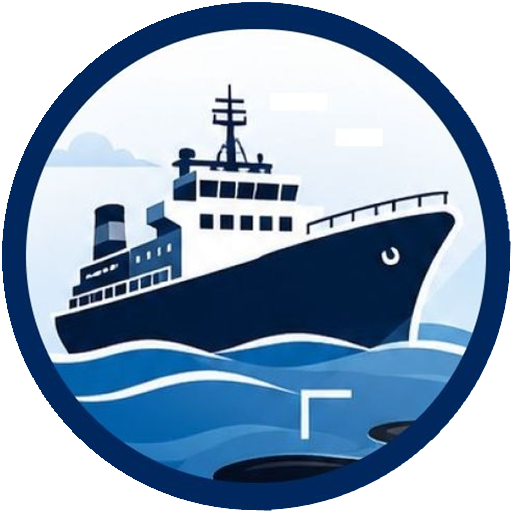

# NAUKA — Maritime Oil-Spill Intelligence

**SAR oil-spill detection · physics-based drift backtracking · AIS vessel attribution · 72-hour forecast · coast-guard drill alerts**

*Smart India Hackathon 2026 · Problem Statement **PS-143** · NTRO Oil Spill Detection Challenge*


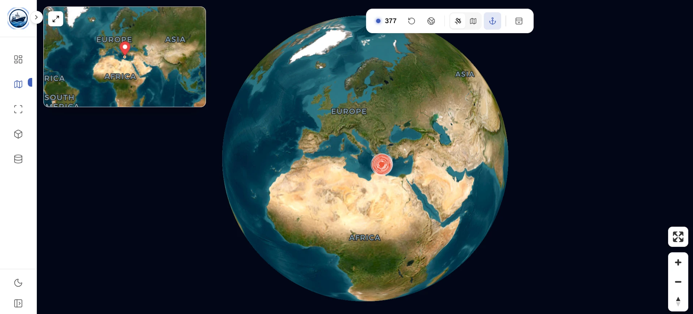

</div>

> [!NOTE]
> **For judges:** this README is written so you can understand the whole system — the ML model, the backend physics, the scoring maths and every screen — **without opening the live app**. Every screenshot is a real capture of the running project, and every number is taken from the project's own outputs, test runs or the sample PDF report in [`docs/samples/`](docs/samples/NAUKA_evidence_spill_327728.pdf).

---

## Table of contents

1. [The problem and our answer](#1-the-problem-and-our-answer)
2. [Results at a glance](#2-results-at-a-glance)
3. [System architecture](#3-system-architecture)
4. [Product tour (screenshots)](#4-product-tour-screenshots)
5. [ML layer — detection from Sentinel-1 SAR](#5-ml-layer--detection-from-sentinel-1-sar)
6. [Backend layer — drift, attribution, forecasting](#6-backend-layer--drift-attribution-forecasting)
7. [Frontend layer — what this repository contains](#7-frontend-layer--what-this-repository-contains)
8. [Key calculations (all formulas in one place)](#8-key-calculations-all-formulas-in-one-place)
9. [Datasets and data sources](#9-datasets-and-data-sources)
10. [Getting started](#10-getting-started)
11. [Repository structure](#11-repository-structure)
12. [Testing and verification](#12-testing-and-verification)
13. [Known limitations (read this)](#13-known-limitations-read-this)
14. [Roadmap](#14-roadmap)
15. [Team, licence and acknowledgements](#15-team-licence-and-acknowledgements)

---

## 1. The problem and our answer

When a **Synthetic Aperture Radar (SAR)** satellite pass shows a dark slick on the sea, responders need three answers fast:

| # | Question | NAUKA's answer | Layer |
|---|---|---|---|
| 1 | **Is it really oil?** (not a look-alike such as a low-wind patch or algae bloom) | **U-Net++** segmentation on dual-polarisation (**VV / VH**) Sentinel-1 data → georeferenced polygon + confidence score | ML |
| 2 | **Where did it come from, and when?** | **Backward Monte-Carlo hindcast** of the slick through **ERA5 wind + CMEMS ocean currents** → probable release point, time and uncertainty radius | Backend |
| 3 | **Which vessel was there?** | **AIS spatio-temporal correlation** + **6-signal behavioural scoring** → ranked candidate vessels | Backend |
| 4 | **Where will it go next, and who must be told?** | **Forward forecast** to the coast, nearest coast-guard station, severity/ETA and a **drill alert** e-mail | Backend + Frontend |
| 5 | **Can a court or a commander read the result?** | An **evidence dossier** and a downloadable **PDF evidence report** with every figure and the endpoint it came from | Frontend |

> [!IMPORTANT]
> NAUKA is an **end-to-end pipeline**: raw GeoTIFF → detection polygon → drift hindcast → vessel ranking → forecast → alert → PDF. Each stage is independently tested, and each hand-off uses the same JSON contract.

---

## 2. Results at a glance

### Detection model (held-out **Part III** test set — never seen in training or validation)

| Metric | Value | Note |
|---|---|---|
| Validation IoU (best checkpoint, epoch 23) | **0.6576** | Parts I + II |
| Overall IoU @ threshold **0.85** | **0.6858** | 450 unseen scenes |
| Oil-region IoU | **0.5108** | |
| **Recall** | **0.627** | tuned for fewer missed spills |
| **Precision** | **0.744** | |
| False-alarm rate on no-oil / look-alike scenes | **22.67 %** | hard negatives included |
| **ONNX ↔ notebook mask IoU** | **0.9877** | proves the exported model behaves like the trained one |
| ONNX ↔ PyTorch numerical parity | checked per export | logit range verified on a reference scene |

### Detection catalogue shown in the dashboard

| KPI | Value |
|---|---|
| **Total detected spills** | **377** satellite events |
| **Total spill area** | **1405.52 km²** |
| **Average detection confidence** | **70 %** |
| **Largest spill** | **48.58 km²** (`spill_f4581c`) |

### Attribution engine

| Parameter | Value |
|---|---|
| Hindcast ensemble | **100 particles**, seeded inside a **500 m** radius of the slick centroid |
| Windage coefficient | **3 %** of wind velocity |
| Candidate search corridor | **30 km** around the estimated origin |
| Temporal window | **± 2 h** around estimated release |
| Scoring signals | **6** (proximity, timing, slowdown, loiter, approach, departure) |
| Forecast horizon | up to **72 h**, 15-minute waypoints |

### Frontend quality gates

| Check | Result |
|---|---|
| `npm test` (Vitest) | **14 files · 157 tests · all passing** |
| `npm run build` | succeeds |
| Coast-guard stations bundled | **6** Hellenic Coast Guard port stations (Crete), with source and photo licence metadata |

---

## 3. System architecture

### 3.1 Three layers, one contract

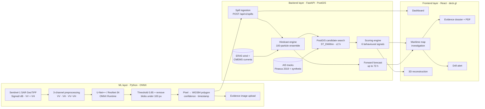

### 3.2 What happens when a user investigates a spill

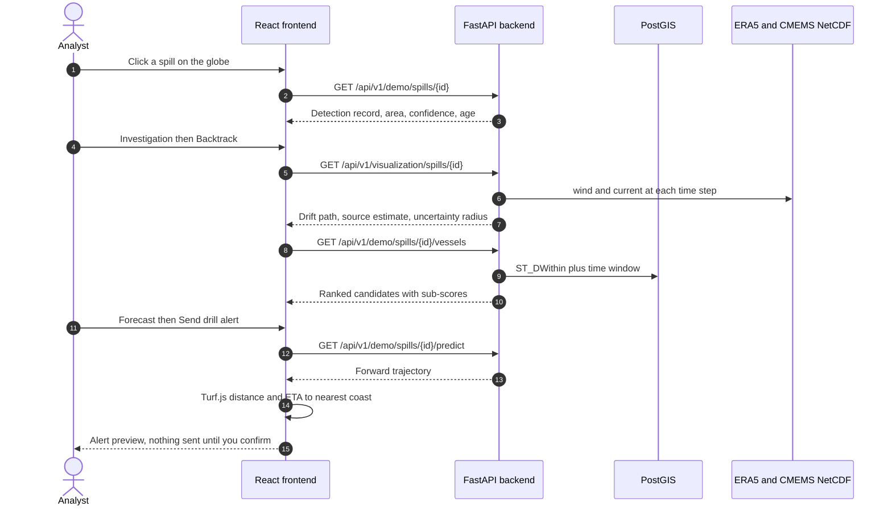

### 3.3 End-to-end data flow

| Stage | Input | Process | Output | Where |
|---|---|---|---|---|
| 1 | Raw Sentinel-1 GeoTIFF (2 bands) | Normalise, build 3 channels, U-Net++ inference | Probability map | `ml_layer/` |
| 2 | Probability map | Threshold, speckle filter, contour → lat/lon | GeoJSON polygon, confidence, acquisition time | `ml_layer/export_payload_unet.py` |
| 3 | Detection JSON | Ingest, store | Catalogue entry | backend `/api/v1/spills` |
| 4 | Observation + wind + currents | Backward Lagrangian ensemble | Source centroid, radius, release time | backend `HindcastService` |
| 5 | Source estimate + AIS | Spatial/temporal query + scoring | Ranked vessels | backend `AttributionEngine` |
| 6 | Same spill, forward in time | Forward drift | 72 h trajectory | backend `DriftEngine` |
| 7 | All of the above | Render, compute coast ETA, build report | Map, 3D scene, dossier, PDF, alert | **this repository** |

---

## 4. Product tour (screenshots)

### 4.1 Dashboard — situational awareness in one glance

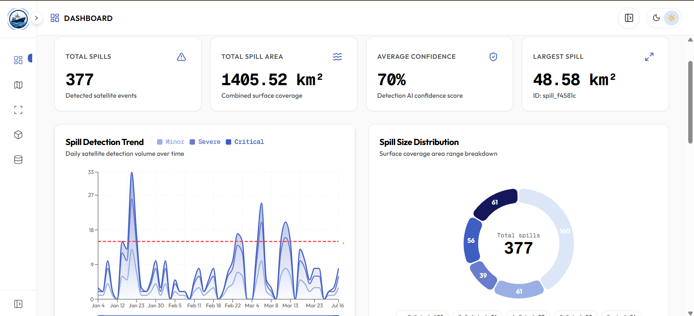

- Four KPI cards: **total spills, total area, average confidence, largest spill**.
- **Spill Detection Trend** — daily volume split into *Minor / Severe / Critical*, with a dashed alert threshold line.
- **Spill Size Distribution** — donut chart of area buckets (total **377**).
- Filter bar by **date range, confidence, area and size bucket**; table with drawer preview of any spill.
- KPIs are computed in the browser from the backend's paginated spill list.

### 4.2 Globe and regional map


- MapLibre **globe projection**, opening over the Mediterranean; the camera flies into the detection region.
- Satellite (Esri World Imagery) or Standard (Carto) basemaps; dark and light themes.
- **Spill markers** are sized by area; a **2D inset map** (top-left) keeps regional context.

### 4.3 Investigation — backtrack, vessels, forecast, alert

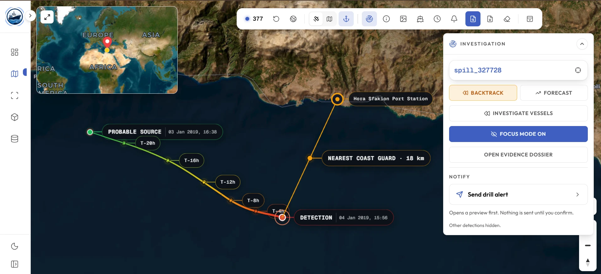

Selecting a spill (`spill_327728` here) opens the **Investigation** panel:

| Control | What it does |
|---|---|
| **Backtrack** | Draws the drift path from detection back to the **probable source** with `T-4h … T-20h` time ticks (here: source **03 Jan 2019 16:38** → detection **04 Jan 2019 15:56**) |
| **Forecast** | Forward path with `T+Nh` ticks and a **coastal-impact** banner (severity, ETA, distance to coast) |
| **Investigate vessels** | Plays the timeline with candidate AIS tracks moving in sync |
| **Focus mode** | Isolates the selected spill and hides other detections |
| **Nearest coast guard** | Line and distance to the closest station (here **Hora Sfakion Port Station, 18 km**) |
| **Send drill alert** | Opens a **preview first — nothing is sent until you confirm** |
| **Open evidence dossier** | Full multi-section report (next section) |

### 4.4 Evidence dossier — six sections, every number sourced

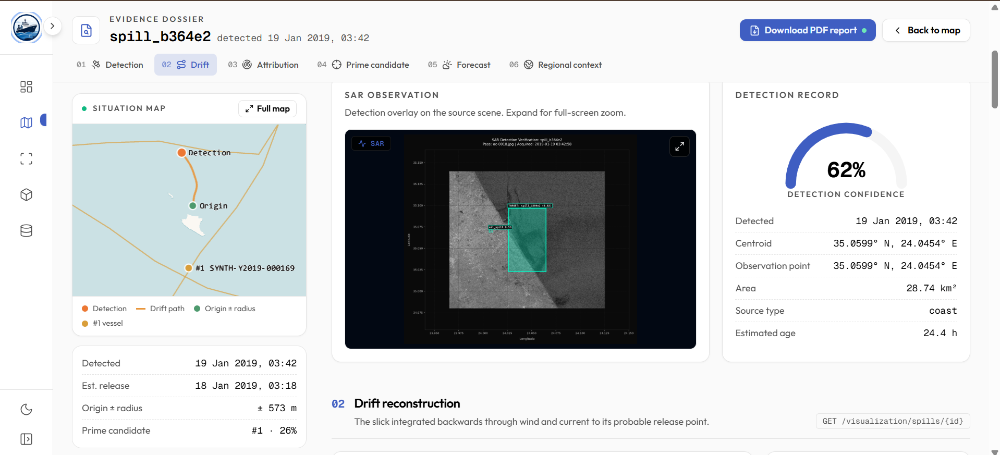

| Section | Content |
|---|---|
| **01 Detection** | SAR observation with detection overlay, **confidence gauge** (62 % in this example), centroid, area (28.74 km²), source type, estimated age (24.4 h) |
| **02 Drift** | Reconstructed path, origin ± radius (**± 573 m**), forcing compass (wind and current at detection) |
| **03 Attribution** | Signal matrix and radar chart across all candidate vessels |
| **04 Prime candidate** | Identity, AIS track, approach/departure profile |
| **05 Forecast** | Forward drift and coastal ETA |
| **06 Regional context** | Detection-over-time and size distribution for the region |

The same data downloads as a **PDF evidence report** (11 pages) — see the [sample report](docs/samples/NAUKA_evidence_spill_327728.pdf). Its first page states the assessment in plain language, for example: *"slick (0.56 km², detection confidence 73 %) was backtracked 30.1 km over 23.3 h to its probable release point"*, and every section is stamped with the API endpoint that produced it.

### 4.5 3D incident reconstruction

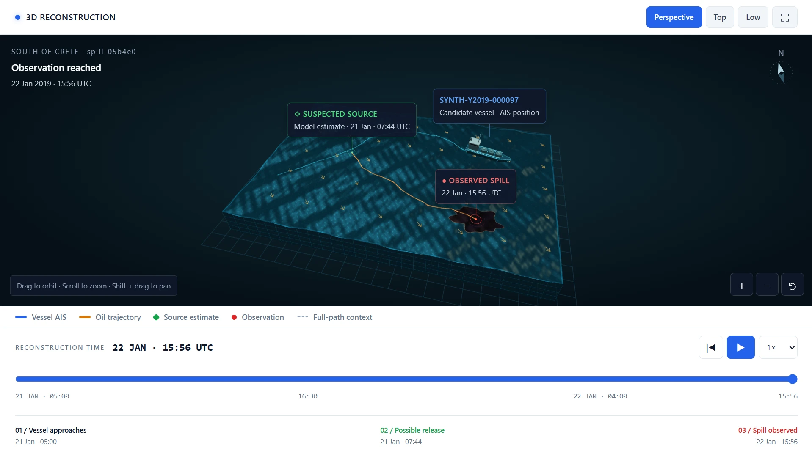

- A **React-Three-Fiber** scene with a Gerstner-wave ocean (custom shaders), a 3D vessel model, the oil trajectory, **suspected source**, **observed spill** and the full-path context.
- **Playback timeline** from vessel approach → possible release → spill observed, with speed control, camera presets (Perspective / Top / Low) and fullscreen.
- Header pill shows **DEMO DATA / LIVE DATA** provenance, so a viewer always knows whether pieces were simulated.

### 4.6 SAR Oil-Spill Detection Lab

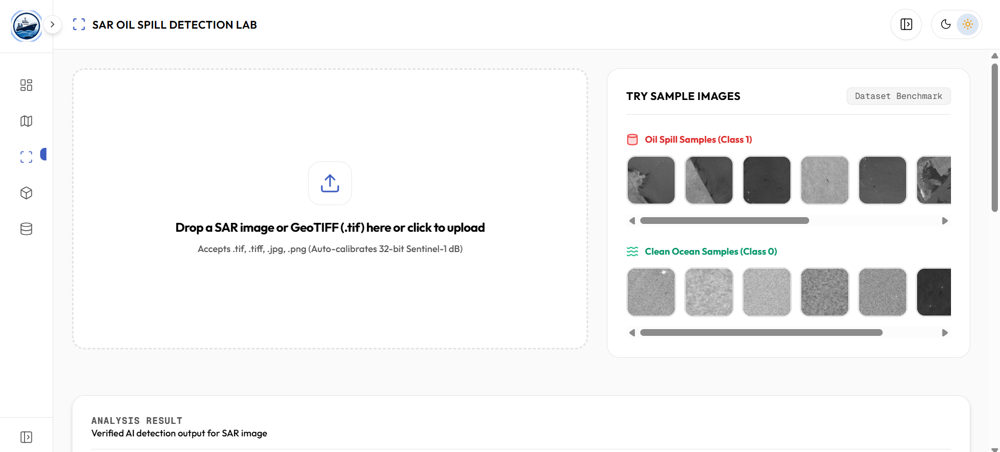

- Drop a **SAR image or GeoTIFF** (`.tif`, `.tiff`, `.jpg`, `.png`) to send it to the hosted detection service; the result card reports spill / no-spill, confidence and detected regions.
- **Try Sample Images** — a benchmark strip of *Oil Spill (Class 1)* and *Clean Ocean (Class 0)* tiles for quick demonstration.
- See [Known limitations](#13-known-limitations-read-this) for exactly what the sample strip does and does not prove.

---

## 5. ML layer — detection from Sentinel-1 SAR

### 5.1 Why the model changed twice

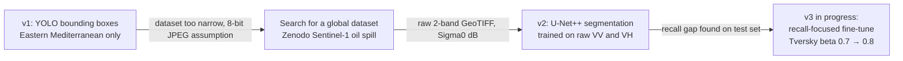

The YOLO pipeline's **supporting infrastructure** (ONNX engine, bbox→GeoJSON georeferencing, Cloudinary upload, JSON payload schema) was kept; only the model behind it changed, so **nothing downstream had to change**.

### 5.2 Model specification

| Item | Value |
|---|---|
| Architecture | **U-Net++**, **ResNet-34** encoder (ImageNet-initialised, no pretrained decoder) |
| Input resolution | **512 × 512** |
| Output | single-channel **sigmoid** probability map |
| Loss | **40 % BCE + 60 % Focal Tversky** (α = 0.3, β = 0.7 in the original run) |
| Why Tversky | lets us **penalise missed spills (false negatives) harder than false alarms** — the right trade-off for disaster response |
| Decision threshold | **0.85** |
| Minimum blob size | **100 px** (removes SAR speckle noise) |

### 5.3 Three input channels — each one earns its place

| Channel | Definition | Physical meaning |
|---|---|---|
| 1 | **VV** normalised | Co-polarisation: vertical transmit, vertical receive. Oil damps capillary waves → dark patch |
| 2 | **VH** normalised | Cross-polarisation: vertical transmit, horizontal receive. Different sensitivity to roughness |
| 3 | `clip(VV_norm − VH_norm, 0, 1)` | **Polarisation difference** — a direct physical contrast signal that helps separate petroleum from **look-alikes** (low-wind zones, algae, biogenic films) |

**Normalisation bounds** (empirically fitted, then independently verified):

| Band | `DB_MIN` | `DB_MAX` |
|---|---|---|
| **VV** | **−48.28 dB** | **−26.77 dB** |
| **VH** | **−30.29 dB** | **−14.44 dB** |

> [!IMPORTANT]
> A raw value of exactly `0.0` is a **no-data / outside-swath sentinel** and is mapped directly to `0` — *not* pushed through the clip-scale formula, where it would be misread as near-maximum backscatter (the opposite of its true meaning).

### 5.4 Dataset (Zenodo Sentinel-1 SAR oil-spill dataset)

| Split | Content | Size | Role |
|---|---|---|---|
| **Part I** | Oil-positive scenes with masks, 2048 × 2048, Sigma0 dB | **1,200** | Train / validation |
| **Part II** | No-oil scenes + **look-alike** hard negatives (masks all-zero) | **685 + 685** | Train / validation |
| **Part III** | Oil / no-oil / look-alike, **150 each** | **450** | **Held-out test only** |

Geographic coverage is global — **Gulf of Mexico, Eastern and Western Mediterranean, Persian Gulf, West Africa, North Sea, Red Sea, Iberian Atlantic, Southeast Asia, Caribbean** — which is why we moved off the single-sea YOLO dataset.

Acquisition timestamps are not shipped with the scenes; they are recovered by scanning the raw TIFF bytes for the embedded **Sentinel-1 product ID** left by the SNAP processing chain. Without this there would be no way to time-correlate a detection against AIS tracks.

### 5.5 Two training bugs that were silently hurting results

| Bug | Symptom | Fix |
|---|---|---|
| **Crop-anchoring crash** | Empty-range error on spills larger than the crop | Require only *overlap* between crop and labelled region |
| **Silent checkpoint failure** | Per-batch IoU/F1 produced `0/0 = nan`; `nan > best_iou` is always `False`, so improved models were **never saved** — with no error | Accumulate **TP / FP / FN / TN over the whole validation set**, compute the ratio **once** |

### 5.6 Making the exported ONNX model trustworthy

| Check | Finding |
|---|---|
| **Band order** | An assumed `[VH, VV]` flip was wrong. `rasterio` already returns `[VV, VH]`; the "fix" introduced a swap. Correct pairing raised fit **R² from ~0.003 to ~0.84** |
| **Stale checkpoint** | An export cell silently exported whatever model was in memory. Every export cell is now self-contained: reload checkpoint, print a **parameter fingerprint**, run a **PyTorch vs ONNX Runtime parity test**, check the logit range on a real scene |
| **End-to-end** | Raw GeoTIFF → preprocessing → ONNX → threshold → connected-component filter compared against the original notebook: **mask IoU 0.9877** |

### 5.7 Production inference pipeline

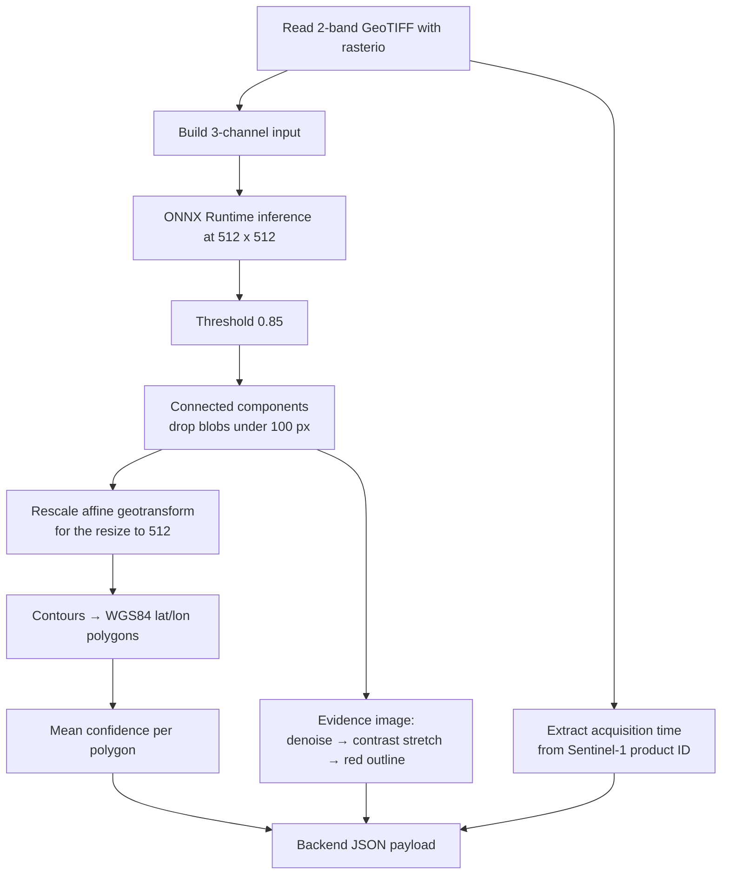

The **evidence image** is drawn from the *same filtered mask* that produces the JSON, so the picture can never show a detection that is not reported. SAR speckle is first denoised (Gaussian blur approximating multi-look averaging) and only *then* contrast-stretched, so the stretch is not calibrated against noise-inflated extremes.

### 5.8 ML repository map

| File | Purpose |
|---|---|
| `export_payload_unet.py` | **Production** segmentation → JSON pipeline |
| `inference_engine.py` | ONNX Runtime engines (`OnnxYoloEngine`, `OnnxUnetEngine`) |
| `evidence_image.py` | Renders and uploads detection evidence images |
| `georeference.py` | Bbox → GeoJSON via bilinear corner interpolation (YOLO path) |
| `export_payload.py` | Shared backend JSON payload schema |
| `ais_correlation.py` | Suspect vessels from AIS: **12 h lookback**, point + trajectory vs buffered polygon |
| `generate_synthetic_ais.py` | Synthetic AIS for controlled tests |
| `train_yolo.py`, `export_yolo.py`, `dataset.py`, `main_pipeline.py`, `api.py` | Original YOLO-era path |
| `visualize_ais.py`, `visualize_val.py` | Plotting helpers |

---

## 6. Backend layer — drift, attribution, forecasting

A **FastAPI 0.110 + Uvicorn** service on **Python 3.11**, backed by **PostgreSQL 15 + PostGIS 3.4** (SQLAlchemy 2 async, asyncpg, GeoAlchemy2), containerised with a multi-stage Docker build.

### 6.1 Attribution pipeline

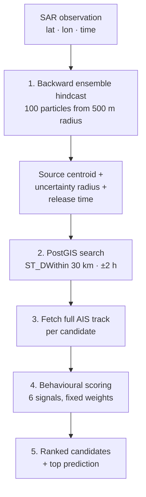

### 6.2 Physics: oil drift

Surface oil moves with the **current** plus a wind-driven fraction (**windage**):

$$\vec v_{drift} = \vec v_{current} + \alpha_{wind}\,\vec v_{wind}, \qquad \alpha_{wind} = 0.03$$

- Position updates use **spherical-Earth geometry** (no flat-Earth shortcut) and a pole guard.
- Handles a **fractional last time-step** so the endpoint lands exactly on the observation time.
- **Forward** (forecast) and **backward** (hindcast) modes share one engine; the ensemble is **vectorised in NumPy**.

| Service | Responsibility |
|---|---|
| `DriftEngine` | Particle tracking, forward and backward, ensemble |
| `HindcastService` | 100 particles within 500 m → returns `centroid_latitude`, `centroid_longitude`, `radius_km` |
| `WeatherService` | Loads **ERA5** 10 m wind and **CMEMS** surface currents with `xarray`; scalar and vectorised `get_velocity(s)` |
| `AttributionEngine` | Orchestrates hindcast → candidates → trajectories → scoring |
| `ScoringEngine` | Six interpretable sub-scores (below); **never reads ground truth** |
| `SpillCatalogService` | In-memory catalogue loaded at start-up |

### 6.3 Vessel scoring model

| Signal | Weight | How it is measured |
|---|---|---|
| **Proximity** | **25 %** | Minimum haversine distance to source centroid (±30 min): `clip(1 − d_km / 5, 0, 1)` |
| **Temporal** | **15 %** | Closest time delta to release: `clip(1 − Δt_min / 120, 0, 1)` |
| **Slowdown** | **20 %** | Speed drop versus pre-event baseline: `clip((v_base − v_event) / v_base, 0, 1)` |
| **Loiter** | **15 %** | Time within 3 km of source (±60 min): `clip(minutes / 30, 0, 1)` |
| **Approach** | **12.5 %** | Fraction of pre-event steps moving **closer** to the source |
| **Departure** | **12.5 %** | Fraction of post-event steps moving **away** from the source |

$$S = 0.25\,P + 0.15\,T + 0.20\,L_{slow} + 0.15\,L_{loiter} + 0.125\,A + 0.125\,D$$

Weights sum to **1.0**. The evidence dossier shows each sub-score for every candidate, plus **verification checks** (inside corridor? inside drift-uncertainty radius? inside release-time window?), so a high score is never a black box.

### 6.3b Worked example (from the sample PDF report, `spill_327728`)

| Quantity | Value |
|---|---|
| Detection | 04 Jan 2019, 15:56 UTC · centroid 35.0507° N, 24.0503° E |
| Slick | **0.56 km²**, confidence **73 %**, estimated age **23.3 h** |
| Backtrack | **30.1 km** over **23.3 h** → origin 35.1589° N, 23.7502° E, **± 0.51 km** |
| Estimated release | 03 Jan 2019, 16:38 UTC |
| Forcing at detection | wind **4.40 m/s** (261°), current **0.149 m/s** (124°) |
| Prime candidate | `SYNTH-Y2019-000063` (passenger) · **26 %** · passed origin **1.7 h** after release at **20.91 km** |
| Why it ranks #1 | out-scores others on **slowdown by +66 points** (72 % vs 6 %) |
| Candidates | 4 (1 prime + 3 comparison baselines) |

### 6.4 API reference

Base path `/api/v1` · interactive docs at `/docs` (OpenAPI) and `/redoc`.

| Group | Method + endpoint | Purpose |
|---|---|---|
| System | `GET /health`, `GET /health/ready` | Liveness; DB readiness |
| Drift | `POST /drift/forward` | Forward drift from a point and time |
| | `POST /drift/hindcast` | Backward ensemble → source centroid |
| | `GET /drift/predict/{spill_id}?hours=6&timestep_minutes=15` | Forecast by spill ID (max 72 h) |
| | `GET /drift/{spill_id}/diagnostic-plot` | Cloudinary SAR diagnostic plot URL |
| Attribution | `POST /attribution` | Full end-to-end vessel attribution |
| Ingestion | `POST /spills`, `GET /spills`, `GET /spills/{id}` | ML pipeline → catalogue |
| Demo catalogue | `GET /demo/spills`, `GET /demo/spills/{id}` | **Used by the dashboard and map** |
| | `GET /demo/spills/{id}/vessels` | Candidate vessels with sub-scores |
| | `GET /demo/spills/{id}/attribution/trajectory` | AIS tracks for timeline playback |
| | `GET /demo/spills/{id}/predict` | Forward forecast |
| | `POST /demo/spills/{id}/backtrack` | Backtrack for the 3D reconstruction |
| Visualisation | `GET /visualization/spills/{id}` | Trajectory + environment + source estimate |

<details>
<summary><b>Example attribution request and response</b></summary>

```json
// POST /api/v1/attribution
{
  "observation_latitude": 36.5,
  "observation_longitude": 28.3,
  "observation_time": "2019-07-15T18:00:00Z",
  "drift_duration_hours": 6.0,
  "synthetic_only": true,
  "scenario_id": "scenario_003"
}
```

```json
{
  "source_estimate": { "latitude": 36.42, "longitude": 28.18, "radius_km": 4.7 },
  "estimated_release_time": "2019-07-15T12:00:00+00:00",
  "candidate_count": 5,
  "top_prediction": "VESSEL_XYZ",
  "candidates": [
    {
      "vessel_id": "VESSEL_XYZ",
      "score": 0.7821,
      "proximity_score": 0.94, "temporal_score": 0.88, "slowdown_score": 0.72,
      "loiter_score": 0.65, "approach_score": 0.80, "departure_score": 0.75,
      "closest_distance_km": 0.31, "minimum_event_speed_knots": 1.2
    }
  ]
}
```
</details>

### 6.5 Database

| Table | Content |
|---|---|
| `vessels` | MMSI, name, type, flag |
| `ais_positions` | AIS fixes with PostGIS `geometry(Point, 4326)` |
| `oil_spill_detections` | ML detections: polygon, centroid, `detected_at` |

Indexes: a **GiST** index on `geom` for fast `ST_DWithin`, and a composite `(vessel_id, timestamp)` index for time-window queries.

### 6.6 Backend testing

Backend tests (pytest + pytest-asyncio) cover: forward/backward drift, **ensemble-vs-scalar parity**, hindcast, all six scoring sub-scores, attribution integrity, synthetic AIS fixtures, five end-to-end **scenario runners** (`run_scenario_001…005`), weather loading and multi-year stitching, demo catalogue and visualisation endpoints.

---

## 7. Frontend layer — what this repository contains

### 7.1 Routes

| Route | Page | Reached from |
|---|---|---|
| `/` | **Dashboard** — KPIs, charts, filters, table | Landing page |
| `/maritime-map` | **Globe + investigation** | Sidebar |
| `/test-image` | **SAR detection lab** | Sidebar |
| `/3d-visualisation` | Standalone WebGL "Ocean Sentinel" scene | Sidebar |
| `/incident-overview` | Full paginated spill table | Sidebar |
| `/incidents` | Searchable incident list | Dashboard row → drawer → *view incident* |
| `/incident-reconstruction?id=…` | **3D reconstruction** | `/incidents` row |

### 7.2 Features and the data behind them

| Feature | What the user gets | Data source |
|---|---|---|
| **Spill markers** | All detections sized by area; click to select | `GET /demo/spills` |
| **Backtracked drift** | Path, `T-Nh` ticks, source badge, uncertainty radius | `GET /visualization/spills/{id}` |
| **Investigation timeline** | Play / scrub 0.5–4× forward or backward; **Focus mode** morphs the slick along the path | derived from the above |
| **Vessel attribution layer** | Ranked tracks, hover tooltip with name, MMSI and **data source (Observed / Synthetic AIS)** | `/vessels`, `/attribution/trajectory` |
| **"Who did this" reveal** | Scripted camera sequence to a 3D ship model, info card, distance ruler | rank-1 vessel |
| **Forecast + coastal alert** | Forward heat/path layer, severity legend, **ETA and distance to coast** computed in-browser with **Turf.js** against a bundled **Natural Earth 10 m** Mediterranean coastline | `GET /demo/spills/{id}/predict` |
| **Nearest coast guard** | Station icons, line, distance, photo, organisation and source link | static `public/data/coast-guard-stations.json` |
| **Drill alert** | Preview modal → send via **EmailJS** (or `mailto:` fallback); logged locally; **always a drill — goes to a demo inbox, never to a real station** | EmailJS |
| **Evidence dossier** | Six sections with Recharts charts | all of the above |
| **PDF report** | 11-page multi-section PDF built in the browser (**jsPDF + autotable**), prepared in the background | all of the above |
| **Dashboard** | KPIs, trend, size donut, heatmap, filters | `GET /demo/spills?page=N` aggregated client-side |
| **3D reconstruction** | R3F ocean, vessel, trajectory, intelligence panel, evidence chain | backend + clearly labelled simulated fill-ins |
| **Dark / light theme** | Persisted; the map basemap follows | local |

### 7.3 Drill-alert flow

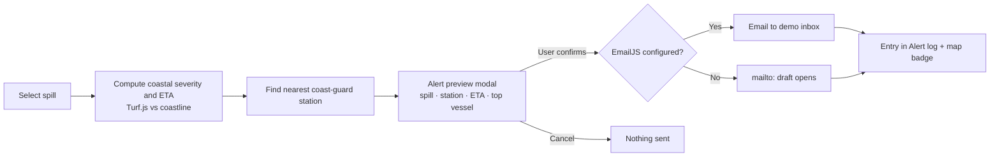

### 7.4 Tech stack

| Layer | Technology | Used for |
|---|---|---|
| UI | **React 19**, **React Router 7**, **TypeScript**, **Vite 8** | App shell, lazy-loaded routes |
| Styling | **Tailwind CSS 3**, Lucide icons, framer-motion | Layout, theming, motion |
| Map | **MapLibre GL 6** (globe projection) | Basemap, camera, inset map |
| Map layers | **deck.gl 9** (`core`, `layers`, `mapbox`, `extensions`, `mesh-layers`) | Spills, paths, forecast, vessels, stations, 3D ship mesh |
| Geo maths | **Turf.js 7** | Distances, buffers, nearest station, coast proximity |
| 3D | **three.js**, **@react-three/fiber**, **@react-three/drei** | Reconstruction scene, ocean shaders |
| Charts | **Recharts 3** | Dashboard and dossier |
| Reports | **jsPDF** + **jspdf-autotable** | PDF evidence report |
| Alerts | **@emailjs/browser** | Drill alert e-mail |
| Quality | **Vitest 5**, **oxlint**, **tsc** | Tests, lint, types |
| Hosting | **Vercel** (`vercel.json` SPA rewrite) | Deployment |

### 7.5 External services

| Service | Host | Used for |
|---|---|---|
| Backend API | `https://naavss.duckdns.org` (override with `VITE_API_BASE_URL`) | Spills, drift, vessels, forecast |
| Detection service | `https://oil-spillage-detection.onrender.com/predict` | SAR upload lab |
| Tiles | Esri World Imagery, Carto | Basemaps |
| E-mail | EmailJS | Drill alerts |

---

## 8. Key calculations (all formulas in one place)

| # | Calculation | Formula / rule | Layer |
|---|---|---|---|
| 1 | **Band normalisation** | $x_{norm} = \mathrm{clip}\!\left(\dfrac{x_{dB} - DB_{min}}{DB_{max} - DB_{min}},\,0,\,1\right)$, raw `0.0` → `0` | ML |
| 2 | **Polarisation difference** | $c_3 = \mathrm{clip}(VV_{norm} - VH_{norm},\,0,\,1)$ | ML |
| 3 | **Compound loss** | $\mathcal{L} = 0.4\,\mathcal{L}_{BCE} + 0.6\,\mathcal{L}_{FTL}$ | ML |
| 4 | **Tversky index** | $TI = \dfrac{TP}{TP + \alpha\,FP + \beta\,FN}$, $\alpha = 0.3$, $\beta = 0.7$ (raising $\beta$ to 0.8 for recall) | ML |
| 5 | **Validation metrics** | IoU, F1 from **TP/FP/FN/TN accumulated over the whole set**, ratio taken once | ML |
| 6 | **Speckle filter** | drop connected components under **100 px** | ML |
| 7 | **Pixel → geo** | affine geotransform rescaled for 512 resize → WGS84 | ML |
| 8 | **Drift velocity** | $\vec v = \vec v_{current} + 0.03\,\vec v_{wind}$ | Backend |
| 9 | **Hindcast** | 100 particles in 500 m disc, integrate backward → centroid + radius | Backend |
| 10 | **Proximity score** | $\mathrm{clip}(1 - d/5\text{ km},0,1)$ | Backend |
| 11 | **Temporal score** | $\mathrm{clip}(1 - \Delta t/120\text{ min},0,1)$ | Backend |
| 12 | **Slowdown score** | $\mathrm{clip}\!\big((v_{base} - v_{event})/v_{base},0,1\big)$ | Backend |
| 13 | **Loiter score** | $\mathrm{clip}(\text{min within 3 km}/30,0,1)$ | Backend |
| 14 | **Total vessel score** | $0.25P + 0.15T + 0.20L_s + 0.15L_l + 0.125A + 0.125D$ | Backend |
| 15 | **Coastal distance / ETA** | Turf.js distance from forecast path to coastline extract; ETA from the first predicted waypoint that reaches it | Frontend |
| 16 | **KPI aggregates** | total, sum of area, mean confidence and maximum area from the spill list | Frontend |

---

## 9. Datasets and data sources

| Dataset | Source | Size / coverage | Used for |
|---|---|---|---|
| **Sentinel-1 SAR oil-spill dataset** | **Zenodo** (Parts I–III) | 1,200 oil · 685 no-oil · 685 look-alike · 450 test, 2048², Sigma0 dB (VV, VH) | Train / validate / test the detector |
| **ERA5 wind** | Copernicus Climate Data Store | 10 m u/v, yearly NetCDF `era5_wind_YYYY-*.nc` | Drift forcing |
| **CMEMS ocean currents** | Copernicus Marine Service | eastward/northward surface currents, `med_currents_YYYY-*.nc` | Drift forcing |
| **Piraeus AIS 2019** | Real AIS records | Jan–Dec 2019, 12 monthly CSVs | Real-world candidate tracks |
| **Synthetic AIS** | Generated (`generate_synthetic_ais.py`, scenario runners) | Controlled scenarios with known ground truth | Evaluating attribution without exposing real vessels |
| **Natural Earth 10 m coastline** | Natural Earth | Mediterranean extract bundled in the frontend | Distance and ETA to coast |
| **Coast-guard stations** | Hellenic Coast Guard / OSM | **6** Crete port stations with provenance | Nearest-station layer, alerts |
| **Open-Meteo grid** | Open-Meteo (fetched **offline**) | 24 × 14 world wind/current grid | Optional ocean-flow particle overlay |
| **Basemap tiles** | Esri World Imagery, Carto | — | Map backgrounds |

---

## 10. Getting started

### 10.1 Run the frontend

**Prerequisites:** a recent Node.js (developed on Node 24) and npm.

```bash
git clone https://github.com/nik-G-54/PS_143.git
cd PS_143
npm install
npm run dev          # Vite prints the local URL (default http://localhost:5173)
```

The app talks to the hosted backend by default, so it works out of the box.

| Command | Purpose |
|---|---|
| `npm run dev` | Vite dev server |
| `npm run build` | Production build to `dist/` |
| `npm run preview` | Serve the production build |
| `npm test` | Vitest — run from the **repository root** |
| `npm run lint` | oxlint |
| `npm run typecheck` | `tsc --noEmit` (see limitations) |
| `node scripts/generateOceanFlowData.js` | Refresh `public/ocean-flow-data.json` from Open-Meteo (offline step; the app never calls Open-Meteo at runtime) |
| `node scripts/analyze-spill-locations.mjs [--cached]` | Dev utility: distance from each spill to nearest station |

### 10.2 Environment variables

Copy `.env.example` to `.env`. All variables are optional.

| Variable | Effect |
|---|---|
| `VITE_API_BASE_URL` | Backend base URL (default `https://naavss.duckdns.org`) |
| `VITE_EMAILJS_SERVICE_ID`, `VITE_EMAILJS_TEMPLATE_ID`, `VITE_EMAILJS_PUBLIC_KEY` | Enable real drill-alert e-mails; unset → a `mailto:` draft opens |
| `VITE_EMAILJS_TO_EMAIL` | Demo inbox that receives every drill alert |
| `VITE_USE_MOCK_API` | `true` → reconstruction uses bundled mock scenarios |

> Restart the dev server after editing `.env` — Vite reads it only at start-up. No secrets are committed.

### 10.3 Run the backend (Docker)

```bash
git clone <backend-repo-url>        # TODO: add link
cd oil-spill-backend
# place .env in the root (POSTGRES_*, DATABASE_URL, CDSAPI_KEY, CLOUDINARY_*)
docker compose up --build           # API at http://localhost:8000, docs at /docs
```

| Compose service | Image | Port | Memory |
|---|---|---|---|
| `postgres` | `postgis/postgis:15-3.4` | internal only | 512 MB |
| `api` | built from `Dockerfile` (multi-stage, non-root user) | `8000` | 1 GB |

Runtime data (not in git): `json_output/`, `data/weather/raw/yearly/` (ERA5), `data/ocean/raw/yearly/` (CMEMS), `data/ais/raw/piraeus/`. Missing folders log an error but do not crash start-up, so the API degrades to **demo-only** mode.

Backend tests: `pip install -r requirements-dev.txt && pytest`.

### 10.4 Run the ML pipeline

```bash
git clone <ml-repo-url>             # TODO: add link
# place the ONNX model and a Sentinel-1 GeoTIFF, then:
python ml_layer/export_payload_unet.py   # scene → georeferenced detection JSON
```

---

## 11. Repository structure

```text
PS_143/                       (this repository: frontend)
├── index.html · vite.config.js · tailwind.config.js · vercel.json
├── public/
│   ├── data/                 coast-guard-stations.json, station photos, coastline extract
│   ├── 3d-visualisation/     standalone WebGL scene
│   ├── samples/              sample SAR thumbnails for the lab
│   └── ocean-flow-data.json  offline wind/current grid
├── scripts/                  generateOceanFlowData.js, analyze-spill-locations.mjs
├── docs/
│   ├── screenshots/          images used in this README
│   └── samples/              sample PDF evidence report
└── src/
    ├── pages/                Dashboard, MaritimeMap, ImageTest, Incidents, IncidentReconstruction…
    ├── features/
    │   ├── maritime-map/     map, layers, investigation, evidence, alerts, charts, api, hooks
    │   └── image-detection/  SAR upload lab
    ├── components/           dashboard, incident (3D), investigation, layout, ui
    ├── systems/ocean/        Gerstner-wave ocean shaders
    ├── services/ · hooks/ · context/ · utils/ · types/
    └── config/               map and reconstruction settings
```

<details>
<summary><b>Backend and ML repository layouts</b></summary>

```text
oil-spill-backend/
├── app/
│   ├── main.py · core/ (config, database)
│   ├── models/          ais, spill, drift, schemas
│   ├── repositories/    ais, attribution, spill  (all DB access)
│   ├── routers/         drift, attribution, spills, demo_spills, visualization
│   └── services/        drift_engine, hindcast_service, weather_service,
│                        attribution_engine, scoring_engine,
│                        spill_catalog_service, visualization_service
├── db/init/01_init.sql  PostGIS schema
├── scripts/             ingestion, scenario runners, diagnostics, ERA5 download
├── tests/               pytest suite
├── Dockerfile · docker-compose.yml
└── data/ · json_output/ (runtime, git-ignored)

ml_layer/
├── export_payload_unet.py  inference_engine.py  evidence_image.py
├── georeference.py  export_payload.py  ais_correlation.py
├── generate_synthetic_ais.py  visualize_*.py
└── train_yolo.py  export_yolo.py  dataset.py  main_pipeline.py  api.py  (YOLO path)
```
</details>

---

## 12. Testing and verification

| Layer | What is verified | Result |
|---|---|---|
| Frontend | Alert building, alert log, send state, coastline/station config and more (**Vitest**) | **157 / 157 passing** |
| Frontend | Production build (`vite build`) | Succeeds |
| ML | PyTorch ↔ ONNX numerical parity; logit range; **end-to-end mask IoU 0.9877** vs notebook | Passed |
| ML | Held-out **Part III** evaluation | IoU 0.6858 · recall 0.627 · precision 0.744 |
| Backend | pytest: drift, hindcast, scoring, attribution integrity, scenarios 001–005 | Suite in backend repo |

---

## 13. Known limitations (read this)

We would rather state these plainly than let a headline metric imply otherwise.

> [!WARNING]
> **Model recall gap.** Direct inspection of the held-out set found genuine, labelled oil spills where the model's probability never exceeds ≈ **0.10**; sweeping the threshold down to 0.35 recovers none, so this is a *learning* gap, not a tuning issue. A recall-focused continuation (Tversky **β 0.7 → 0.8**, same verified preprocessing/export) is in progress. We tested falling back to the original YOLO model and it produced **zero** detections on this data, so we deliberately did **not** wire in a wrong-but-confident fallback.

| Area | Limitation | Honest framing |
|---|---|---|
| **Vessel identity** | Candidates in the demo carry **synthetic identifiers** (`SYNTH-Y2019-…`) and several are labelled **comparison baselines**. The report states "Synthetic placeholders (not registry identifiers)". | NAUKA demonstrates the *method*; it does not name real polluters |
| **AIS source** | Real **Piraeus 2019** AIS exists in the backend; demo scenarios use synthetic AIS for controlled evaluation. **No live AIS feed.** | Retrospective analysis, not real-time |
| **Data set** | The UI is driven by the backend's `/demo/` dataset, centred on the **Mediterranean (Crete)**; all six coast-guard stations are Greek | A demonstration region, not a national feed |
| **SAR lab samples** | The *Try Sample Images* strip returns **stored example results**, and image corner coordinates sent for uploads are fixed to a demo box — so sample tiles illustrate the UI, not live inference | Use the Part III numbers in §2 for model quality |
| **SAR lab static text** | Header text on `/test-image` (accuracy and inference-time badges, "ONNX WebAssembly") is **static copy**; inference actually runs on a hosted server | Do not read it as a measured benchmark |
| **Illustrative panels** | The "8-step verification" panel on SAR-lab results is an **illustrative walkthrough**, not computed attribution | |
| **3D scene** | Slick *shape* is procedurally generated from the path and backend area, not an observed footprint; missing pieces are filled with simulated data and the header pill says **DEMO DATA** | |
| **Wind/current overlay** | The windy-style particle layer and its offline data generator exist but the on-map toggle is not exposed in the current toolbar; wind/current **values** still appear in the forcing card and dossier | |
| **Static analysis** | `npm run typecheck` currently reports **49 type errors** (several in unused files); `vite build` does not type-check, so the build works | Clean-up planned |
| **Coverage** | Detector tuned and tested on Sentinel-1; thresholds were tuned on Mediterranean-heavy scenes | Needs wider validation |

---

## 14. Roadmap

| Priority | Item |
|---|---|
| High | Finish the **recall-focused** retraining (β 0.8) and re-validate on Part III with the same parity checks |
| High | Replace synthetic identifiers with **licensed live AIS** and add a registry lookup |
| Medium | Re-expose the **wind/current particle overlay** toggle; wire the offline grid to the forecast view |
| Medium | Real coast-guard contact registry and a production alert channel (currently drill-only) |
| Medium | Return the **observed polygon footprint** to the 3D scene instead of a procedural shape |
| Low | Fix remaining TypeScript errors; remove unused dependencies and dead modules |
| Low | Streaming ingestion for near-real-time Sentinel-1 passes |

---

## 15. Team, licence and acknowledgements

| | |
|---|---|
| **Team** | TODO: team name |
| **Members** | TODO: names and roles (ML · backend · frontend) |
| **Live demo** | TODO: URL |
| **Demo video / presentation** | TODO: links |
| **Backend repository** | TODO: link |
| **ML repository** | TODO: link |
| **Licence** | TODO |

**Acknowledgements:** ESA **Copernicus Sentinel-1**, the **Zenodo** SAR oil-spill dataset authors, **ECMWF ERA5**, **Copernicus Marine (CMEMS)**, **Natural Earth**, **OpenStreetMap contributors**, the **Hellenic Coast Guard** (public station information), Esri and Carto basemaps, and the open-source maps, 3D and charting libraries listed above.

<div align="center">

*Built for the Smart India Hackathon 2026 — PS-143, NTRO Oil Spill Detection Challenge.*

</div>
